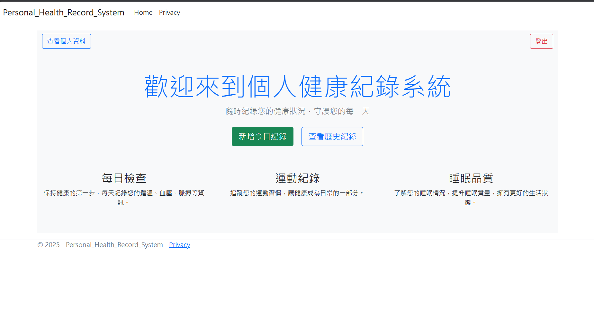
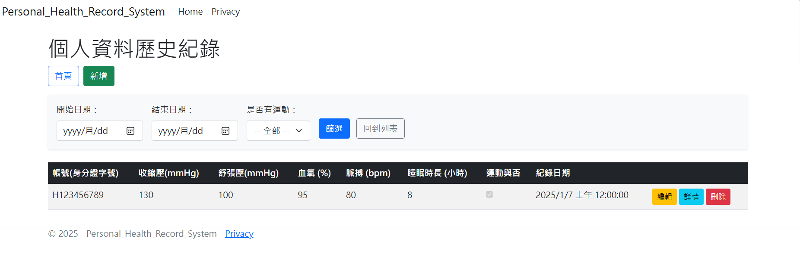

# 個人健康紀錄系統 Personal Health Record System

「網頁程式設計（二）」課程專案（慈濟大學，113 學年度第 1 學期）。

這是一套用 **ASP.NET Core MVC** 開發的個人健康紀錄網站。使用者註冊並登入後，可以記錄每天的血壓、血氧、脈搏、體溫、血糖、睡眠、運動與三餐。系統會依照設定的參考範圍，為每一筆紀錄產生健康提醒。

> 本系統是課程練習作品。健康分析使用的參考範圍只用來示範功能，不能當作醫療建議。

## 系統畫面

**登入後的主頁**



**健康紀錄列表與篩選**



## 功能說明

### 1. 會員註冊與登入
- **註冊**：填寫帳號（身分證字號）、密碼、基本資料、聯絡資訊、緊急聯絡人、身高體重、病史與生活習慣。
- **重複帳號檢查**：送出時，後端會檢查帳號是否已被註冊。
- **登入**：輸入帳號與密碼，驗證成功後把帳號存進 Session，之後的頁面都依照這個帳號顯示資料。
- **錯誤提示**：帳號不存在時顯示「無此帳號，請註冊。」，密碼錯誤時顯示「密碼錯誤。」。

### 2. 個人資料
- 查看與編輯自己的基本資料、緊急聯絡人、病史與生活習慣。
- 性別、睡眠、早餐、運動、吸菸、飲酒、嚼檳榔習慣都用下拉選單選擇，資料庫中以列舉（enum）儲存。

### 3. 每日健康紀錄（CRUD）
| 類別 | 欄位 |
|---|---|
| 血壓 | 收縮壓、舒張壓（mmHg） |
| 生理指標 | 血氧（%）、脈搏（bpm）、體溫（°C） |
| 血糖 | 空腹血糖、飯後血糖（mg/dL） |
| 睡眠與運動 | 睡眠時長（小時）、當天是否運動 |
| 飲食 | 早餐、午餐、晚餐（沒吃填「無」） |
| 時間 | 紀錄日期 |

- **新增**：帳號會自動從 Session 帶入，使用者不用自己輸入。
- **查看、編輯、刪除**：在歷史紀錄列表中操作。
- **只看得到自己的紀錄**：列表只顯示目前登入帳號的資料。

### 4. 篩選歷史紀錄
可以依照**開始日期、結束日期**與**是否有運動**篩選，三個條件可以自由組合。

### 5. 健康分析
在單筆紀錄的詳情頁按「分析健康狀況」，系統會逐項檢查並列出提醒：

| 項目 | 觸發提醒的條件 |
|---|---|
| 血壓偏高 | 收縮壓 > 120 或舒張壓 > 80 |
| 血壓偏低 | 收縮壓 < 90 或舒張壓 < 60 |
| 血氧過低 | 血氧 < 95% |
| 脈搏異常 | 脈搏 < 60 或 > 100 |
| 體溫過高 | 體溫 > 37.5°C |
| 空腹血糖異常 | < 70 或 > 99 mg/dL |
| 飯後血糖異常 | < 70 或 > 140 mg/dL |
| 睡眠時間異常 | < 7 或 > 8 小時 |
| 未運動 | 當天沒有運動 |
| 三餐不完整 | 任一餐填寫「無」 |

所有項目都正常時，會顯示「恭喜您！您的健康狀況一切正常」。

## 系統架構

本專案採用 **MVC（Model-View-Controller）** 架構：

| 層 | 檔案 | 負責內容 |
|---|---|---|
| Model | `Models/personal.cs`、`Models/Health.cs` | 定義使用者與健康紀錄的欄位、資料驗證（`[Required]`）與顯示名稱（`[Display]`） |
| View | `Views/Home`、`Views/personals`、`Views/Healths` | 使用 Razor 語法與 Bootstrap 製作頁面 |
| Controller | `HomeController`、`personalsController`、`HealthsController` | 處理登入、註冊、CRUD、篩選與健康分析的邏輯 |
| Data | `Data/Personal_Health_Record_SystemContext.cs` | Entity Framework Core 的 DbContext，對應資料庫中的兩張資料表 |

### 頁面流程
```
登入頁 (Home/Index)
 ├─ 註冊 (personals/Create) ──> 回到登入頁
 └─ 登入成功 ──> 主頁 (Home/Login)
                  ├─ 查看個人資料 (personals/Details) ──> 編輯 (personals/Edit)
                  ├─ 新增今日紀錄 (Healths/Create)
                  └─ 查看歷史紀錄 (Healths/Index)
                       ├─ 篩選 (Healths/Filter)
                       ├─ 編輯 / 刪除
                       └─ 詳情 (Healths/Details) ──> 健康分析 (Healths/Analyze)
```

### 資料庫設計

| 資料表 | 說明 | 主要欄位 |
|---|---|---|
| `personal` | 使用者資料 | Id、Account、Password、Name、DateOfBirth、Gender、聯絡資訊、緊急聯絡人、Height、Weight、病史、生活習慣 |
| `Health` | 每日健康紀錄 | Id、Account、血壓、血氧、脈搏、體溫、血糖、睡眠、運動、三餐、RecordDate |

兩張表用 `Account` 欄位對應使用者，資料表結構由 EF Core Migrations 產生（`Migrations/` 資料夾）。

## 使用的技術與工具

| 類別 | 技術 |
|---|---|
| 語言 | C#、HTML、CSS、JavaScript |
| 後端框架 | ASP.NET Core MVC（.NET 8） |
| ORM | Entity Framework Core 8（Code First、Migrations） |
| 資料庫 | SQL Server LocalDB |
| 前端 | Razor、Bootstrap 5、jQuery、jQuery Validation |
| 狀態管理 | ASP.NET Core Session |
| 開發工具 | Visual Studio 2022 |

## 專案結構

```
├── Personal Health Record System.sln
├── Database/
│   ├── schema_and_sample_data.sql      建立資料表與示範資料的 SQL 腳本
│   └── *.mdf / *_log.ldf               LocalDB 資料庫檔案（內容皆為測試用假資料）
├── screenshots/                        README 使用的系統畫面截圖
└── Personal Health Record System/
    ├── Controllers/                    HomeController、personalsController、HealthsController
    ├── Models/                         personal、Health、ErrorViewModel
    ├── Views/                          Razor 頁面
    ├── Data/                           DbContext
    ├── Migrations/                     EF Core Migrations
    ├── wwwroot/                        CSS、JavaScript、Bootstrap、jQuery
    ├── Program.cs                      服務註冊（DbContext、Session、MVC）與路由設定
    └── appsettings.json                資料庫連線字串
```

## 如何執行

### 環境需求
- Visual Studio 2022，安裝「ASP.NET 與網頁程式開發」工作負載
- .NET 8 SDK
- SQL Server Express LocalDB（Visual Studio 安裝時可勾選）

### 方法一：用 Migrations 建立資料庫（建議）
1. 下載或 clone 這個 repo，用 Visual Studio 開啟 `Personal Health Record System.sln`。
2. 選「工具」>「NuGet 套件管理員」>「套件管理器主控台」，執行：
   ```
   Update-Database
   ```
3. 按 F5 執行，在登入頁按「註冊」建立帳號。

### 方法二：用 SQL 腳本建立資料庫（含示範資料）
1. 在「SQL Server 物件總管」連到 `(localdb)\MSSQLLocalDB`，新增一個資料庫，名稱和 `appsettings.json` 裡 `Database=` 的名稱相同。
2. 對這個資料庫執行 `Database/schema_and_sample_data.sql`。
3. 執行專案，用示範帳號 `DEMO000001`、密碼 `demo1234` 登入。

### 方法三：直接使用 .mdf 檔
`Database` 資料夾裡附有開發時使用的 LocalDB 資料庫檔案，內容皆為測試用的假資料。把 `appsettings.json` 的連線字串加上 `AttachDbFilename`，指向 `.mdf` 檔的完整路徑。例如：
```
Server=(localdb)\\mssqllocaldb;Database=Personal_Health_Record_SystemContext-27da7408-b740-4e4d-8502-4b89dcba5e51;AttachDbFilename=C:\\你的路徑\\Database\\Personal_Health_Record_SystemContext-27da7408-b740-4e4d-8502-4b89dcba5e51.mdf;Trusted_Connection=True;MultipleActiveResultSets=true
```

## 已知限制與可改進方向

這個專案是課程作業，以下是我之後想改進的地方：

- **密碼以明碼儲存**：應該改用雜湊（例如 ASP.NET Core Identity 的 PasswordHasher）。
- **登出沒有清除 Session**：目前登出只是跳回登入頁，應該呼叫 `HttpContext.Session.Clear()`。
- **頁面沒有登入檢查**：直接輸入網址可以進入健康紀錄頁面，應該加上授權檢查。`personals/Index` 也會列出所有使用者，應該限制只有管理者能看。
- **即時帳號檢查沒有作用**：註冊頁的 AJAX 呼叫 `Personal` 控制器，但實際名稱是 `personals`，所以即時檢查會失敗。目前重複帳號只能在送出表單時由後端擋下。
- **兩張表沒有設外鍵**：`Health.Account` 和 `personal.Account` 只靠程式對應，可以改成用外鍵關聯。
- **欄位格式驗證**：身分證字號、手機號碼可以加上格式檢查。
